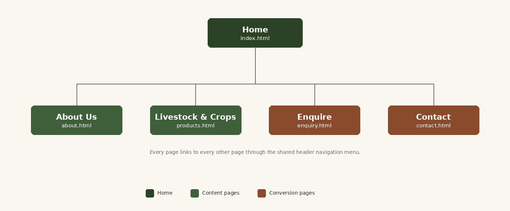
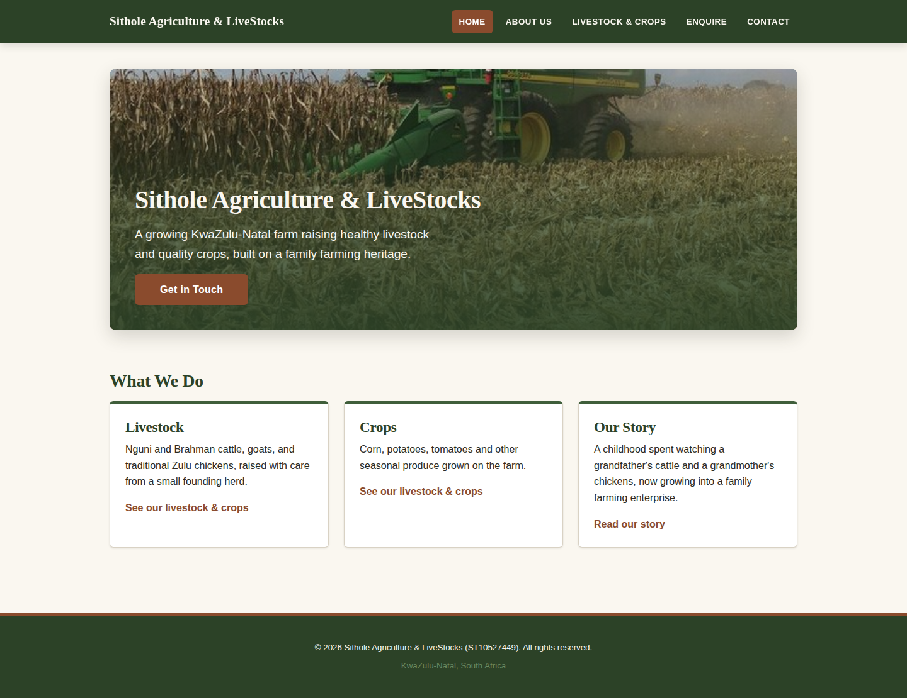
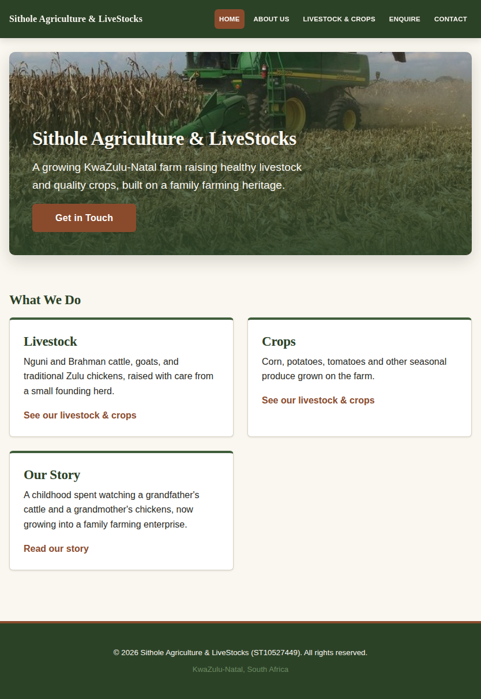
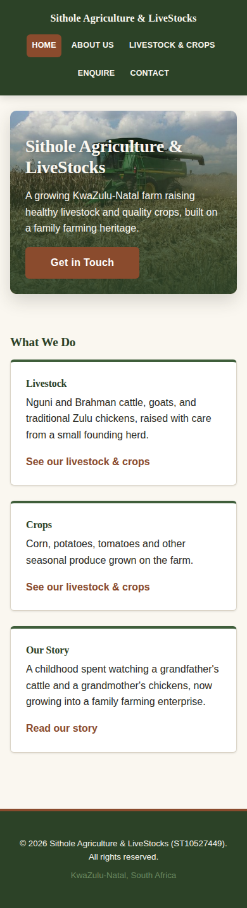

# Sithole Agriculture & LiveStocks Website

**Module:** Web Development (Introduction)
**Assessment:** Portfolio of Evidence (PoE)
**Institution:** The Independent Institute of Education (IIE)

## Student Information

Name: Njabulo Sithole 
Student Number :ST10527449 
Group: Individual
Current Submission: part 3 Adding Functionality and SEO |
Live Website: `https://sithole-agriculture.netlify.app` 

## Project Overview

Sithole Agriculture & LiveStocks is a livestock and crop-farming enterprise based in
KwaZulu-Natal, South Africa. The organisation raises Nguni and Brahman cattle, goats
and traditional Zulu chickens, and grows corn, potatoes and tomatoes across two farm
locations Mnambithi (Limehill) and Bergville.

This website gives the farm its first online presence. It introduces the business and
its founding story to the wider community, showcases the livestock breeds and crops on
offer, and provides a direct route for individual buyers and wholesale organisations to
make enquiries.

The site is built with HTML, CSS and JavaScript across three submissions:

Part 1: HTML structure and content (complete)
Part 2: CSS styling and responsive design (complete)
Part 3: JavaScript functionality and SEO (this submission)

## Website Goals and Objectives

Goals

1. Introduce the farm and its story to the wider community as a new venture.
2. Showcase the livestock breeds and crops on offer, and generate enquiries from buyers.
3. Build early trust and credibility as the operation grows.

Key Performance Indicators

- Number of enquiries received through the contact and enquiry forms.
- Website visits and unique visitors.
- Click-through rate from the Livestock & Crops page to the enquiry form.

## Key Features and Functionality

Page - File - Purpose 
Home: `index.html` Hero banner, introduction, farm-in-numbers counters, Explore the Farm tabs, photo gallery with lightbox 
About Us: `about.html` Founding story, mission and vision, FAQ accordion 
Livestock & Crops: `products.html` Cattle, goats and chickens; corn, potatoes and tomatoes; searchable stock catalogue 
Enquire: `enquiry.html` Enquiry form with validation, instant availability response and background (AJAX) sending 
Contact: `contact.html`  Two farm locations, interactive map, Google Maps, contact form that compiles an email 

Part 3 features

- Tabs, accordion, photo gallery with lightbox, animations and count-up numbers (JavaScript)
- Interactive Leaflet map with a "Find my nearest farm" button
- Stock catalogue built by JavaScript, with live search, category filter and sorting
- Enquiry and contact forms with HTML5 + JavaScript validation and clear error messages
- Enquiry form: instant availability response and AJAX sending; contact form: compiles an email to the chosen farm
- SEO: unique titles, meta descriptions and keywords, Open Graph tags, structured data, `robots.txt`, `sitemap.xml`
- Deployed on a free hosting platform; version-controlled with Git and GitHub

Part 2 features

- External stylesheet linked to all five pages
- Earthy green / terracotta / cream colour scheme applied through CSS custom properties
- Serif heading and sans-serif body typography on a 1.2 modular type scale
- CSS Grid card and panel layouts; Flexbox header, media sections and forms
- Interactive `:hover`, `:focus` and `:active` states on links, buttons, cards and form fields
- Responsive design at three breakpoints with responsive images via `srcset` / `sizes`
- Accessibility: skip link, visible focus outlines, `prefers-reduced-motion` support

## Sitemap

All five pages share a common header, navigation menu and footer. Every page links to
every other page, so the navigation is fully connected in both directions.

## File and Folder Structure

sithole-agriculture-website/
│
├── index.html             Home: hero, numbers, tabs, gallery
├── about.html             Story, mission, vision, FAQ accordion
├── products.html          Livestock and crops + searchable catalogue
├── enquiry.html           Enquiry form
├── contact.html           Contact details, maps, contact form
├── 404.html               Friendly "page not found" page
├── robots.txt             Tells search engines what they may crawl
├── sitemap.xml            Lists every page for search engines
├── _headers               Security + caching headers (Netlify)
├── README.md
│
├── css/
│   └── style.css          All styling (Part 2 base + Part 3 components)
│
├── js/
│   ├── farm-data.js       Farms, livestock, crops and emails (single source of truth)
│   ├── validation.js      Validation rules (name, email, SA phone, date, quantity, length)
│   ├── forms.js           Connects the rules to both forms; enquiry response; contact email
│   ├── catalogue.js       Builds the stock cards; search, filter, sort
│   ├── lightbox.js        Photo viewer (native <dialog>)
│   ├── map.js             Leaflet map, nearest-farm finder
│   └── script.js          Tabs, accordion, scroll reveal, count-up numbers
│
├── images/
│   ├── corn-harvest-hero.jpg      + 360w / 540w / 720w variants
│   ├── corn-harvest.jpg           + 360w / 540w / 720w variants
│   ├── esibayeni-kraal.jpg        + 360w / 540w / 720w variants
│   ├── cattle-herd.jpg            + 360w / 540w / 720w variants
│   ├── cattle-grazing.jpg         + 360w / 540w / 720w variants
│   ├── potato-rows.jpg            + 360w / 540w / 720w variants
│   ├── potatoes.jpg               + 360w / 540w variants
│   └── favicon.svg                browser-tab icon
│
├── docs/
│   └── screenshots/       (responsive testing evidence)
│
└── Document/
    └── Sithole_Agriculture_LiveStocks_Website_Proposal.docx

## Part 3 Details

### 4.1 Interactive elements (JavaScript, no libraries needed)

Feature - Where - How it works 

|Tabs - Home: "Explore the Farm" `script.js`. WAI-ARIA tabs pattern: arrow keys, Home/End, `aria-selected`. Panels link to the catalogue filtered by category, and to the map. 
|Accordion - About Us: FAQ `script.js`. Buttons with `aria-expanded`, one answer open at a time, smooth open/close. 
|Modal lightbox gallery - Home gallery + catalogue photos  `lightbox.js` on a native `<dialog>`: previous/next, arrow keys, Esc, click outside to close, counter, caption, focus returns to the photo you opened. 
|Animations and transitions - Site-wide | CSS transitions on buttons, cards and photos; hero text fade-up; sections fade in on scroll (`IntersectionObserver`); numbers count up. All motion is switched off for visitors who choose "reduce motion". 
|Interactive map - Contact  `map.js` with Leaflet + OpenStreetMap: a marker and popup for each farm, buttons that fly to Limehill or Bergville, "Show both", and **Find my nearest farm** (browser geolocation, only when the button is pressed; distance by the haversine formula). The two Google Maps embeds stay below as a street-level backup. 
|Advanced DOM manipulation - Catalogue, forms, lightbox | Cards, lightbox, error messages, the enquiry response and the email preview are built with `createElement` and `textContent` (never `innerHTML`, so typed text cannot inject HTML), plus event delegation, `URLSearchParams` and conditional form fields. 

### 4.2 Dynamic content and search

- The **Browse Our Stock** section on the Livestock & Crops page is generated by `catalogue.js` from `js/farm-data.js`. To add an animal or crop, add one entry to that file.
- **Live search** (name, category, description; every word typed must match), a **category filter** (livestock / crops) and **sorting** (name A–Z / Z–A, category).
- Live result count, a friendly "nothing matches" message with a clear button, and shareable links such as `products.html?category=crops`.
- The data is a `.js` file rather than `.json` on purpose: browsers block `fetch()` of local files, so the site also works when a page is opened straight from the folder.

### 4.3 Forms and validation

Both forms use HTML5 attributes (`required`, `type`, `min`/`max`, `minlength`/`maxlength`, `autocomplete`, `inputmode`) **and** JavaScript validation (`validation.js` + `forms.js`).

| Check | Rule |
|---|---|
| Name | 2 to 60 characters: letters (including accented), spaces, hyphens, apostrophes |
| Email | Valid format, up to 100 characters |
| Phone | South African format (`0604027620` or `+27604027620`; spaces and dashes allowed). Optional, but **required** if the visitor wants a phone call back |
| Date (needed by) | A real calendar date, from today up to 12 months ahead |
| Quantity | Whole number: up to 500 animals, 2 000 birds or 100 000 kg |
| Message | Enquiry: 10 to 500 characters. Contact: 20 to 1 000 characters, with a live character counter |
| Dropdowns, radio buttons, consent box | Must be chosen / ticked |

**Error handling:** messages appear beside the field (with a "!" icon, so colour is not the only signal), fields are marked `aria-invalid`, a summary at the top lists every problem with links to the fields, and focus moves there. Fields are checked when you leave them and re-checked as you fix them. Space for each message is reserved, so the form never jumps while you click.

**enquiry.html** (enquire about livestock or crops)

1. The buyer says whether they are an individual or a wholesale buyer, and what they are interested in. Choosing livestock, crops or both reveals an **item** list (only matching items) and a **quantity** box whose label changes with the item (animals, birds or kg).
2. On a valid submit the page **processes the input immediately** and shows a response: the item and quantity, **availability** (compared with the herd size in `farm-data.js`: within the herd, more than the herd, or "depends on the season" for crops), how **pricing** works for that item, the contact details of the chosen farm, and a note for wholesale or individual buyers.
3. At the same time the enquiry is **sent in the background with AJAX (`fetch`)**, with no page reload, to the email of the farm the buyer chose ([FormSubmit](https://formsubmit.co/)). A status line shows *sending / sent / could not send*. If the buyer is offline, the response still shows and call buttons let them reach the farm anyway.
4. The form's `action` attribute points to the same service, so it still works if JavaScript is switched off.
5. Arriving from a catalogue card (`enquiry.html?item=nguni-goats`) pre-selects that item.

**contact.html** (general message to the organisation)

1. Collects name, email, optional phone, preferred reply method, **which farm should receive it**, message type, subject and message.
2. On a valid submit the details are **compiled into an email** (To, Subject such as `[Livestock or crops] Goats & chickens`, and a formatted body) and shown to the visitor.
3. The **Send email** button opens the visitor's email app with that message addressed to the recipient chosen in the form (the farm emails are stored in `js/farm-data.js`). There is also a Copy button and an Edit button.

### 4.4 Search engine optimisation (SEO)

**Keyword research.** I thought about what a buyer in KwaZulu-Natal would type when looking for this farm, and grouped the phrases by intent:

| Intent | Keywords | Used on |
|---|---|---|
| Product | Nguni cattle, Brahman cattle, Nguni goats, Zulu chickens, maize, potatoes, tomatoes | Home, Livestock & Crops |
| Buying | buy livestock KwaZulu-Natal, wholesale maize, livestock for sale, farm produce | Livestock & Crops, Enquire |
| Local | KwaZulu-Natal farm, Limehill farm, Bergville farm | Home, Contact |
| Trust | family farm, farm story, locally grown | About Us, Home |

Keywords are used naturally in headings and text (no stuffing), and each page has its own short list in `<meta name="keywords">`.

**On-page SEO**

| Item | What was done |
|---|---|
| Title tags | Unique per page, 60 characters or fewer, main keyword first |
| Meta descriptions | Unique per page, 120 to 160 characters, with a clear reason to click |
| Meta keywords | 6 to 8 relevant phrases per page |
| Headings | Exactly one `<h1>` per page, then `<h2>` and `<h3>` in order with no skipped levels |
| Images | Descriptive file names (`cattle-herd.jpg`, `potato-rows.jpg`, `esibayeni-kraal.jpg`), meaningful alt text on every image, width/height set, lazy loading below the fold |
| URLs | Short, lowercase and descriptive (`/products.html`, `/enquiry.html`); filters use readable queries (`?category=crops`) |
| Internal linking | Every page links to the others in the header and footer, plus links inside the content (home tabs to the catalogue and map, catalogue cards to a pre-filled enquiry, FAQ answers to enquiry, products and contact) |
| Mobile-friendliness | Viewport meta tag, responsive layouts at 1024px and 640px, no sideways scrolling (tested at 390px wide) |
| Social sharing | Open Graph + Twitter card tags and a canonical link on every page |
| Language and region | `lang="en-ZA"` |
| Local SEO | schema.org `LocalBusiness` structured data (JSON-LD) listing both farm locations with their phone numbers; town names in headings and text; location cards and directions links |

**Off-page SEO plan** (these happen outside the code, so they are a plan rather than finished work)

- **Backlinks:** list the farm in South African farming and livestock directories, ask local agricultural associations and suppliers to link to the site, and share the site with buyers who already know the farm.
- **Social media:** post farm photos (harvests, herd, potatoes) on Facebook, Instagram and WhatsApp status with a link to the site.
- **Local SEO:** create a Google Business Profile for each farm (Limehill and Bergville), keep the name, phone number and area identical everywhere, and ask satisfied buyers for Google reviews.

**Additional requests**

- `robots.txt` allows crawling and points to the sitemap; `sitemap.xml` lists all five pages.
- **Page speed:** one stylesheet, scripts loaded with `defer`, responsive `srcset` images, lazy loading below the fold, the hero loaded first (`fetchpriority="high"`), the decorative page background now uses the 540px photo (142 KB lighter), Leaflet loads only on the contact page.
- **Security:** user text is never inserted with `innerHTML`; links that open a new tab use `rel="noopener noreferrer"`; inputs have length limits; a hidden spam-trap field catches bots; `_headers` adds `X-Content-Type-Options`, `X-Frame-Options`, `Referrer-Policy` and `Permissions-Policy`; the host serves the site over HTTPS; no passwords or private data are stored.

### 4.5 Accessibility

Skip-to-content link (kept from Part 2), labels on every form control, `aria-live` regions for results and errors, keyboard-operable tabs, accordion and lightbox, visible focus outlines, `prefers-reduced-motion` support, and every page still readable if JavaScript is switched off.

### 4.6 Testing

- Validation rules, catalogue search/filter/sort, the enquiry response and the email builder were unit-tested with Node.
- Every page was then run in a real browser (Chromium) and checked automatically: no JavaScript errors; tabs, accordion and lightbox (open, next/previous, wrap-around, Esc, clicking outside, focus return); count-up numbers; catalogue search, filter and sort; every validation message; the enquiry responses and the contact email preview; the offline failure path; the map buttons and nearest-farm finder; "reduce motion"; JavaScript switched off; no broken images or links; no sideways scrolling at mobile width.
- To check by hand: open each page in Microsoft Edge and Chrome, shrink the window to phone width, and try both forms with valid and invalid input.

### 4.7 Deployment

**Netlify (drag and drop)**

1. Go to <https://app.netlify.com/drop> and sign in.
2. Drag the whole website folder onto the page. Netlify publishes it straight away.
3. Open *Site configuration > Change site name* and choose a name, for example `sithole-agriculture`.

**GitHub Pages (alternative)**

1. Push the project to your private GitHub repository (below).
2. Open *Settings > Pages*, choose the `main` branch and the `/ (root)` folder, and save.

**After deploying:** if your address is not `https://sithole-agriculture.netlify.app`, find and replace that text with your real address in `robots.txt`, `sitemap.xml` and the `canonical`, `og:url` and `og:image` tags of the pages. Then submit `sitemap.xml` in Google Search Console.

**Enquiry email set-up:** the first time the enquiry form is submitted on the live site, FormSubmit sends an activation email to the farm address that received it (`mondisetech@gmail.com` or `njabulosjebha@gmail.com`). Open it and confirm once for each address; after that enquiries arrive in that inbox.

### 4.9 Details to confirm (stored in one place so they are easy to change)

- **Herd sizes** in `js/farm-data.js` (25 Nguni cattle, 30 Brahman cattle, 30 Nguni goats, 80 chickens) come from the About Us page. The enquiry form uses them to say whether a buyer's quantity is within the herd. Update them as the herd changes.
- **Map marker positions** are approximate (town level). Check them in `js/farm-data.js`; the Google Maps embeds and "Get directions" links search by name and are not affected.
- **Photos:** the goat, chicken and tomato cards have no photo yet (a coloured band is shown instead). Add a photo and one `image` line in `farm-data.js` to show it.
- **About Us text:** the page says the dream was achieved "in the year 2029". Please check this date.

## Part 1 Details

Part 1 established the foundation of the website:

- Selected and researched the target organisation, and produced two Website Project
  Proposals for lecturer approval.
- Sourced original photography of the farm's cattle, kraal, maize and potato crops.
- Created the folder structure (`css`, `js`, `images`) and the five HTML pages.
- Built the semantic HTML structure using `header`, `nav`, `main`, `section`,
  `article` and `footer`.
- Linked all pages together through a shared navigation menu.

**Part 1 result: 92%**

---

## Part 2 Details

### 2.1 External Stylesheet

A single external stylesheet, `css/style.css`, is linked from the `<head>` of all five
pages. All styling lives in this one file — there are no inline `style` attributes and
no embedded `<style>` blocks anywhere in the project.

### 2.2 Base Style and CSS Reset

The stylesheet opens with a reset that normalises `box-sizing`, strips default margins
and padding, and standardises list, image, form and link defaults so the design starts
from the same baseline in Chrome, Firefox, Edge and Safari.

Base styles then set the site-wide font family, font size, line height, text colour and
background colour.

### 2.3 Typography

| Property | Application |
|---|---|
| `font-family` | Georgia serif stack for headings; Segoe UI sans-serif stack for body |
| `font-size` | Seven-step modular scale (`--text-sm` through `--text-4xl`) |
| `font-weight` | 600 for emphasis and labels, 700 for headings |
| `line-height` | 1.2 for headings, 1.6 for body copy |
| `letter-spacing` | Tightened on headings, widened on uppercase navigation and labels |

The type scale uses a 1.2 "minor third" ratio, so each step is 1.2× the one below it
rather than being chosen arbitrarily.

### 2.4 Layout Structure

- **CSS Grid** — the three-column "What We Do" cards, the Mission/Vision panels, the
  two location cards, the map pair, and the hero (using `grid-template-areas` to stack
  the heading over the photograph in a single named grid cell).
- **Flexbox** — the site header (`justify-content: space-between`), the navigation list,
  the alternating image-and-text media sections (`flex-direction: row-reverse` on
  alternate rows), the form rows, and the sticky-footer body column.

### 2.5 Visual Styles

`color`, `background-color`, `border` and `box-shadow` are used throughout. Interactive
elements respond through pseudo-classes:

| Element | `:hover` | `:focus` | `:active` |
|---|---|---|---|
| Navigation links | Green background | Cream outline | Terracotta background |
| CTA buttons | Darker terracotta, lifts 2px | Green outline | Returns to resting position |
| Text links | Darker terracotta, underline appears | Green outline | Dark green |
| Cards | Lifts 4px, deeper shadow | — | — |
| Form fields | Green border | Green border with focus ring | — |

### 3.1 Breakpoints

| Breakpoint | Width | Changes |
|---|---|---|
| Desktop | Above 1024px | Three-column cards, two-column panels, side-by-side media sections |
| Tablet | 1024px and below | Cards drop to two columns, maps stack, headings step down, nav text shrinks |
| Mobile | 640px and below | Everything single-column, nav wraps and centres, images stack above text, buttons full-width |

### 3.2 Relative Units

`rem` is used for the entire type and spacing scale so the layout scales with the user's
browser font-size setting. `ch` sets the reading line length on paragraphs, `%` and
`vw` handle fluid widths, and `em` governs positioning that should follow local font size.
Fixed pixel values are used only for hairline borders and breakpoint definitions.

### 3.3 Responsive Images

Each content photograph is served at three resolutions (360w, 540w, 720w) through the
`srcset` attribute, with `sizes` telling the browser how much layout width the image will
occupy at each breakpoint. The browser then downloads only the resolution it needs,
which keeps mobile data usage down.

### 3.4 Test and Iterate

The site was tested at desktop, tablet and mobile viewport sizes using browser developer
tools. Screenshot evidence is in `docs/screenshots/` and indexed below.

---

## Responsive Testing Evidence

Rendered in Chromium at three device viewport sizes.

| Page | Desktop (1440×900) | Tablet (834×1112) | Mobile (390×844) |
|---|---|---|---|
| Home | `index-desktop.png` | `index-tablet.png` | `index-mobile.png` |
| About Us | `about-desktop.png` | `about-tablet.png` | `about-mobile.png` |
| Livestock & Crops | `products-desktop.png` | `products-tablet.png` | `products-mobile.png` |
| Enquire | `enquiry-desktop.png` | `enquiry-tablet.png` | `enquiry-mobile.png` |
| Contact | `contact-desktop.png` | `contact-tablet.png` | `contact-mobile.png` |

All files are in `docs/screenshots/`.

### Home page across all three breakpoints

| Desktop | Tablet | Mobile |
|---|---|---|
|  |  |  |

---

## Changelog

### Part 3 — Adding Functionality and SEO

**Interactive elements**

- Replaced the placeholder `js/script.js` with working code: accessible **tabs** ("Explore the Farm" on the Home page), an **accordion** FAQ on the About Us page, **scroll-reveal animations**, and **count-up numbers** ("The Farm in Numbers").
- Added `js/lightbox.js`: a photo lightbox built on `<dialog>`, used by the new Home page gallery (7 photos) and the catalogue photos.
- Added CSS transitions and animations (hero fade-up, card hover, photo zoom, accordion slide), all disabled for visitors who prefer reduced motion.
- Added `js/map.js`: an interactive Leaflet map on the Contact page with markers, popups, fly-to buttons and a "Find my nearest farm" button. The two Google Maps embeds were kept as a street-level backup.

**Dynamic content and search**

- Added `js/farm-data.js` and `js/catalogue.js`: a **Browse Our Stock** catalogue on the Livestock & Crops page, generated by JavaScript, with live search, category filter and sorting. Existing Part 2 content on that page was kept.
- Catalogue cards link to the enquiry form with that item pre-selected.

**Forms**

- Rebuilt the form on `enquiry.html`: added a buyer type (individual or wholesale) option, reply method, item and quantity fields that appear for livestock and crops, preferred farm, needed-by date, character counter and consent box. Existing fields were kept.
- Added HTML5 attributes plus JavaScript validation (`js/validation.js`, `js/forms.js`) with inline errors and an error summary, including South African phone format, date range, quantity range and text length rules.
- The enquiry now **processes the input into an instant availability and pricing response** (using the herd sizes in `farm-data.js`) and sends the enquiry in the background with **AJAX** to the chosen farm's email.
- Rebuilt the contact form on `contact.html`: added phone, reply method, **farm choice**, message type and subject. It **compiles a formatted email** and lets the visitor send it to the recipient of the chosen farm.

**SEO**

- Rewrote the `<title>` and `<meta name="description">` on every page, and added meta keywords, author, robots, canonical, Open Graph and Twitter tags.
- Added `LocalBusiness` JSON-LD structured data (both farms, with phone numbers) to the Home and Contact pages.
- Added the missing `width` and `height` attributes and `loading="lazy"` to content images, and `fetchpriority="high"` to the hero image.
- Added internal links inside page content, a footer navigation on every page, and `id="find-us"` on the map section so other pages can link to it.
- Added `robots.txt`, `sitemap.xml` and a custom `404.html`.

**Performance, security and accessibility**

- The decorative corn background on the Enquiry and Contact pages now uses the 540px photograph (142 KB lighter; the cream overlay hides the difference).
- Scripts now load per page with `defer`; Leaflet loads only on the Contact page.
- Added `_headers` (security and caching headers), `rel="noopener noreferrer"` on external links, input length limits and a hidden spam-trap field.
- Added `lang="en-ZA"`, `aria-live` regions, an `images/favicon.svg` browser-tab icon and keyboard support for all new components.

**Corrections to existing content**

- Fixed spelling in the page text: "hacture" to "hectare" (twice), "KwaZule-Natal" to "KwaZulu-Natal", "bruhman" to "Brahman", "verious" to "various", "imberded" to "embedded", "build the farm" to "built the farm", "on of the largest" to "one of the largest", and "quality in meet" to "quality in meat" and "resistance in pests" to "resistance to pests" on the Livestock & Crops page.
- Enquiry and contact form fields now have clear names (`name`, `email`, `phone`, and so on) so the emails they produce are readable.

### Part 2 — CSS Styling and Responsive Design

**Corrections carried over from Part 1**

- **Restored missing `js/` folder.** All five pages referenced `js/script.js`, but the
  folder was absent from the submitted repository, producing a broken request on every
  page load. The folder and placeholder file have been restored.
- **Removed inline `style` attributes.** `contact.html` and `enquiry.html` each carried
  a `style="background-image: ..."` attribute on the `<body>` tag. These conflicted with
  the Part 2 requirement for an external stylesheet and used an invalid escape sequence
  for the filename. The background is now the `.has-page-background--corn` class in
  `style.css`.
- **Added `alt` text to all images.** Four images across the Home, About and Livestock &
  Crops pages had no `alt` attribute, which is both an accessibility failure and an SEO
  issue ahead of Part 3.
- **Restored the map on the Contact page.** Part 1 required contact information, a map
  and a contact form. The map had been removed; embedded Google Maps for both the
  Limehill and Bergville locations have been reinstated.
- **Renamed image files to web-safe names.** Filenames containing spaces
  (`Corn havesting 1.1.jpeg`) were the cause of the invalid background-image escape.
  All images now use lowercase hyphenated names.
- **Removed presentational `<b>` tags** from the About page body copy. Emphasis is now
  handled in CSS, in line with separating content from presentation.
- **Cleaned placeholder brackets** from the Contact page — real contact details were
  entered in Part 1 but the surrounding `[ ]` markers were left in place.

**New in Part 2**

- Created the full external stylesheet (`css/style.css`), replacing the 15-line Part 1
  placeholder.
- Added a CSS reset for cross-browser consistency.
- Introduced CSS custom properties for the complete colour scheme, type scale and
  spacing scale.
- Applied the earthy green / terracotta / cream palette specified in the approved
  Website Project Proposal.
- Implemented serif/sans-serif typography on a 1.2 modular scale.
- Built the desktop layout using CSS Grid (cards, panels, hero) and Flexbox (header,
  media sections, forms).
- Added `:hover`, `:focus` and `:active` states across navigation, buttons, links, cards
  and form fields.
- Added tablet (≤1024px) and mobile (≤640px) breakpoints with media queries.
- Generated 360w / 540w / 720w variants of every photograph and wired them up with
  `srcset` and `sizes`.
- Added a skip-to-content link, visible focus outlines and `prefers-reduced-motion`
  support for accessibility.
- Added a print stylesheet.
- Captured responsive testing screenshots at three viewport sizes.

### Part 1 — Building the Foundation

- Created the project folder structure (`css`, `js`, `images`).
- Built five HTML pages with semantic structure and a shared navigation menu.
- Integrated researched content and original farm photography.
- Produced the Website Project Proposal for lecturer approval.

---

## References

MDN Web Docs, 2026. *The dialog element.* [Online] Available at:
https://developer.mozilla.org/en-US/docs/Web/HTML/Element/dialog
[Accessed 30 October 2026].

MDN Web Docs, 2026. *Client-side form validation.* [Online] Available at:
https://developer.mozilla.org/en-US/docs/Learn/Forms/Form_validation
[Accessed 30 October 2026].

MDN Web Docs, 2026. *Using the Fetch API.* [Online] Available at:
https://developer.mozilla.org/en-US/docs/Web/API/Fetch_API/Using_Fetch
[Accessed 30 October 2026].

MDN Web Docs, 2026. *Intersection Observer API.* [Online] Available at:
https://developer.mozilla.org/en-US/docs/Web/API/Intersection_Observer_API
[Accessed 30 October 2026].

MDN Web Docs, 2026. *Geolocation API.* [Online] Available at:
https://developer.mozilla.org/en-US/docs/Web/API/Geolocation_API
[Accessed 30 October 2026].

W3C, 2026. *ARIA Authoring Practices Guide: tabs and accordion patterns.* [Online] Available at:
https://www.w3.org/WAI/ARIA/apg/patterns/
[Accessed 30 October 2026].

Leaflet, n.d. *Leaflet: an open-source JavaScript library for interactive maps.* [Online]
Available at: https://leafletjs.com/
[Accessed 30 October 2026].

OpenStreetMap contributors, n.d. *OpenStreetMap copyright and licence.* [Online] Available at:
https://www.openstreetmap.org/copyright
[Accessed 30 October 2026].

Google, 2026. *Search Engine Optimization (SEO) Starter Guide.* [Online] Available at:
https://developers.google.com/search/docs/fundamentals/seo-starter-guide
[Accessed 30 October 2026].

Google, 2026. *Local business structured data.* [Online] Available at:
https://developers.google.com/search/docs/appearance/structured-data/local-business
[Accessed 30 October 2026].

Sitemaps.org, n.d. *Sitemaps XML format.* [Online] Available at: https://www.sitemaps.org/protocol.html
[Accessed 30 October 2026].

FormSubmit, n.d. *FormSubmit: form backend for HTML forms.* [Online] Available at: https://formsubmit.co/
[Accessed 30 October 2026].

Netlify, 2026. *Deploy sites by drag and drop.* [Online] Available at: https://docs.netlify.com/
[Accessed 30 October 2026].

MDN Web Docs, 2026. *CSS grid layout.* [Online] Available at:
https://developer.mozilla.org/en-US/docs/Web/CSS/CSS_grid_layout
[Accessed 16 September 2026].

MDN Web Docs, 2026. *CSS flexible box layout.* [Online] Available at:
https://developer.mozilla.org/en-US/docs/Web/CSS/CSS_flexible_box_layout
[Accessed 16 September 2026].

MDN Web Docs, 2026. *Using media queries.* [Online] Available at:
https://developer.mozilla.org/en-US/docs/Web/CSS/CSS_media_queries/Using_media_queries
[Accessed 16 September 2026].

MDN Web Docs, 2026. *Responsive images.* [Online] Available at:
https://developer.mozilla.org/en-US/docs/Web/HTML/Guides/Responsive_images
[Accessed 16 September 2026].

MDN Web Docs, 2026. *Using CSS custom properties (variables).* [Online] Available at:
https://developer.mozilla.org/en-US/docs/Web/CSS/CSS_cascading_variables/Using_CSS_custom_properties
[Accessed 16 September 2026].

South Africa Online, n.d. *Nguni cattle beef production in South Africa.* [Online]
Available at: https://southafrica.co.za/nguni-cattle.html
[Accessed 12 August 2026].

Van Eeden, Z., 2025. *Nguni: the legacy of the land.* Farmer's Weekly. [Online]
Available at: https://www.farmersweekly.co.za/animals/cattle/nguni-the-legacy-of-the-land/
[Accessed 12 August 2026].

ZADNA, n.d. *.za Domain Name Authority.* [Online] Available at: https://www.zadna.org.za
[Accessed 12 August 2026].

*© 2026 Sithole Agriculture & LiveStocks. Built for WEDE5020 at The Independent
Institute of Education.*
